<p align="center">
  <picture>
    <source media="(prefers-color-scheme: dark)" srcset="public/logo/farmsense-logo-white.png" />
    
  </picture>
</p>

<p align="center">
  <strong>Gestão rural simples, integrada e orientada por dados.</strong><br />
  Rebanho, lavoura e prazos da fazenda em um só lugar.
</p>

<p align="center">
  
  
  
  
  
  
  
  
</p>

<p align="center">
  <a href="#telas">Telas</a> ·
  <a href="#funcionalidades">Funcionalidades</a> ·
  <a href="#como-rodar">Como rodar</a> ·
  <a href="#arquitetura">Arquitetura</a> ·
  <a href="#api-rest">API</a> ·
  <a href="#testes">Testes</a> ·
  <a href="#produção">Produção</a>
</p>

---

## Sobre

O **FarmSense** é um sistema web para pequenas e médias propriedades rurais. Ele reúne as informações de **pecuária** e **agricultura**, que costumam ficar espalhadas em cadernos e planilhas, e as transforma em indicadores, alertas e relatórios para apoiar a tomada de decisão.

O sistema se adapta à fazenda: quem marca só pecuária ou só agricultura no cadastro vê apenas os módulos daquela atividade.

## Telas

<p align="center">
  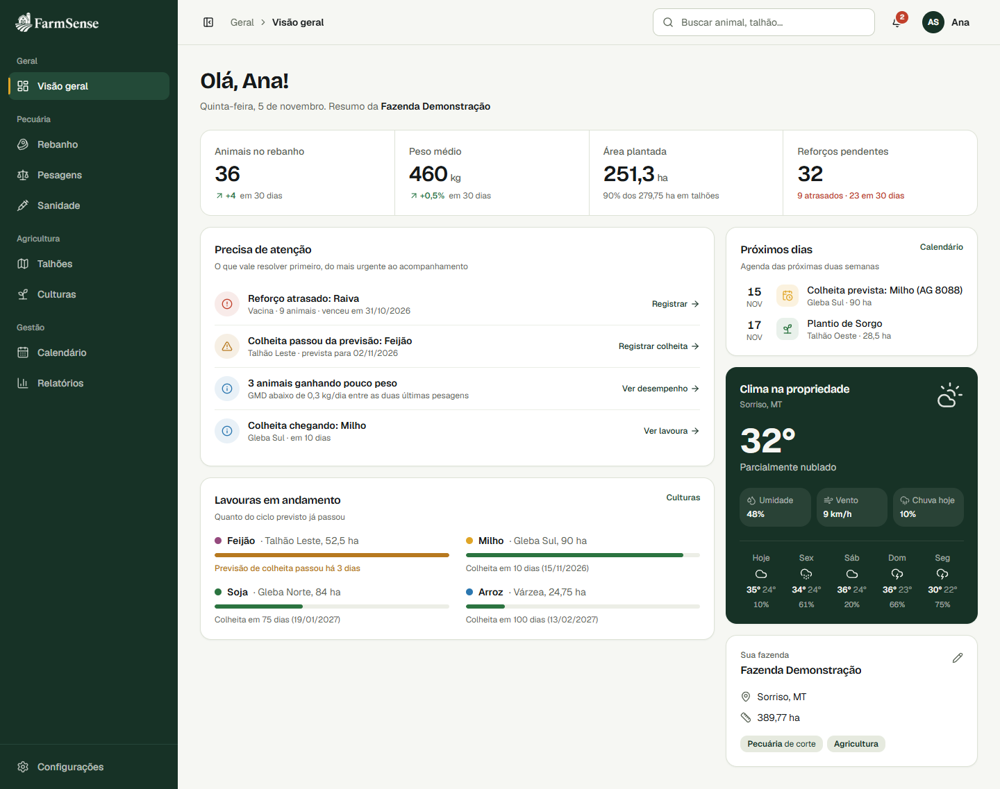
</p>

<table>
  <tr>
    <td width="50%" align="center"><strong>Talhões</strong><br />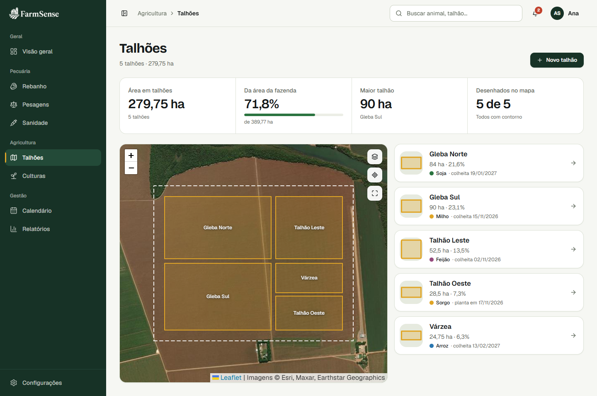</td>
    <td width="50%" align="center"><strong>Culturas</strong><br />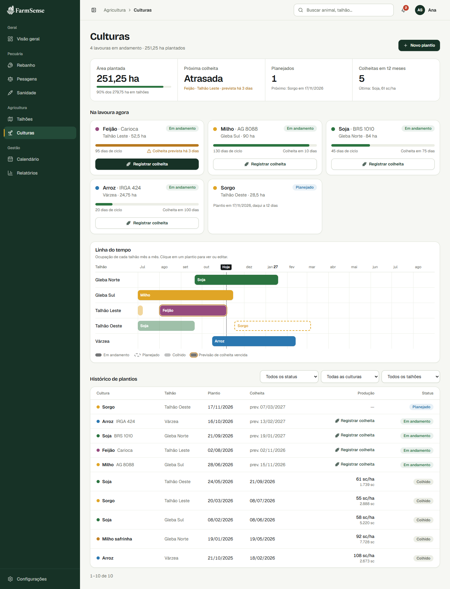</td>
  </tr>
  <tr>
    <td width="50%" align="center"><strong>Relatórios</strong><br />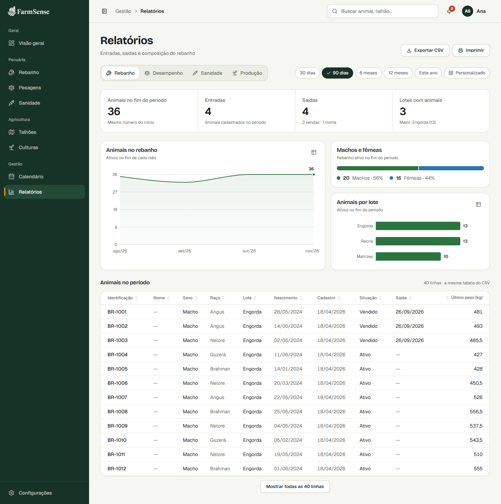</td>
    <td width="50%" align="center"><strong>Detalhe do animal</strong><br />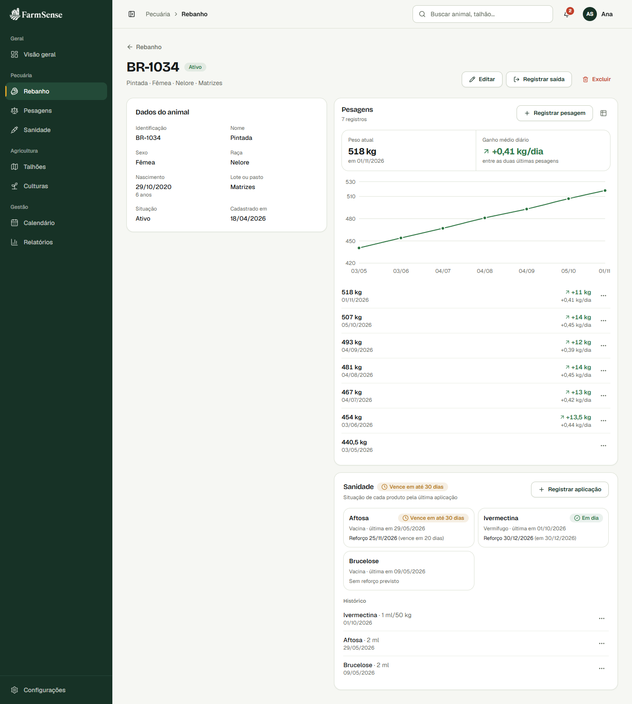</td>
  </tr>
  <tr>
    <td width="50%" align="center"><strong>Sanidade</strong><br />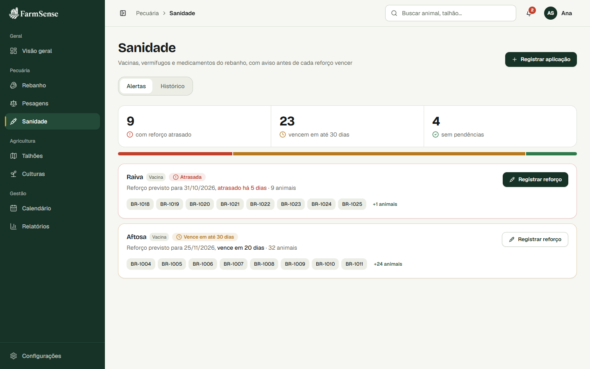</td>
    <td width="50%" align="center"><strong>Calendário</strong><br />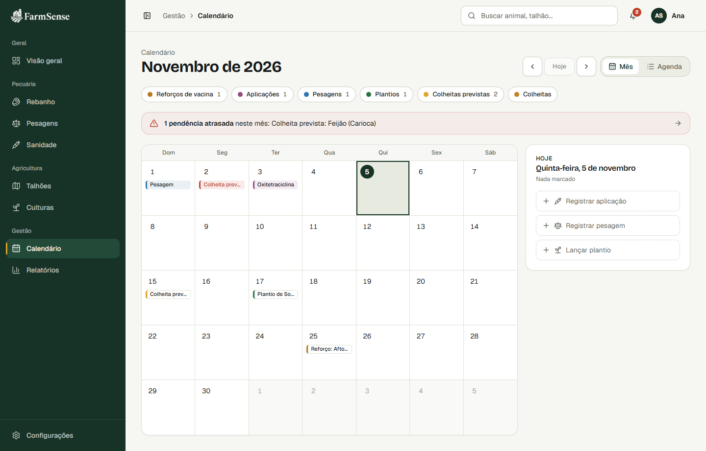</td>
  </tr>
  <tr>
    <td width="50%" align="center"><strong>Registro em lote</strong><br />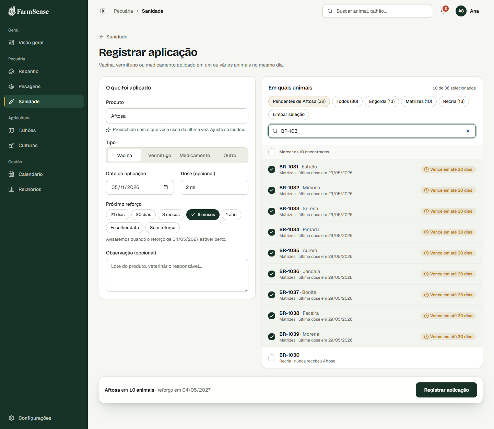</td>
    <td width="50%" align="center"><strong>Login</strong><br />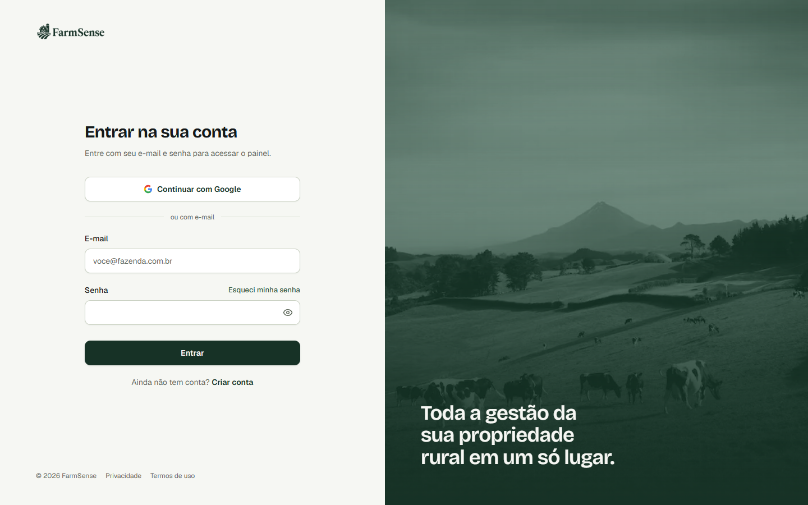</td>
  </tr>
</table>

<sub>Capturas feitas com a <a href="#conta-de-demonstração">conta de demonstração</a>, com dados fictícios.</sub>

## Funcionalidades

### Pecuária

| Módulo | O que faz |
|---|---|
| **Rebanho** | Cadastro individual de animais com busca e filtros por situação, lote e sexo; registro de saída (venda ou morte) preservando o histórico |
| **Pesagens** | Registro em lote, em grade; histórico, gráfico de peso e ganho médio diário (GMD) por animal |
| **Sanidade** | Vacinas, vermífugos e medicamentos com aplicação em lote; alertas de reforço atrasado ou vencendo em até 30 dias |

### Agricultura

| Módulo | O que faz |
|---|---|
| **Talhões** | Contorno desenhado sobre mapa de satélite, com cálculo automático de área; busca de endereço, coordenadas e rota até o talhão |
| **Limite da fazenda** | Importação do perímetro do **CAR** (`.zip`, `.shp`, `.kml`, `.kmz` ou `.geojson`) processada no navegador: o arquivo não vai para o servidor, só o contorno simplificado |
| **Culturas** | Ciclos do plantio à colheita, linha do tempo por talhão, produtividade e bloqueio de ciclos sobrepostos no mesmo talhão |

### Gestão

| Módulo | O que faz |
|---|---|
| **Visão geral** | Primeiros passos, indicadores conforme as atividades da fazenda, itens que precisam de atenção, próximas tarefas e previsão do tempo |
| **Calendário** | Visão mensal e agenda com aplicações, pesagens, reforços, plantios e colheitas |
| **Relatórios** | Rebanho, desempenho, sanidade e produção, com gráficos, exportação em CSV e versão para impressão |
| **Notificações** | Avisos de prazo no sino do painel e resumo por e-mail, que pode ser desligado no perfil |

### Conta e privacidade

- Cadastro em etapas, já com os dados da fazenda, e login por e-mail e senha ou **Google**
- Verificação de e-mail, recuperação e troca de senha, troca de e-mail confirmada por link
- Limite de tentativas nas rotas de autenticação (rate limit) e isolamento dos dados por fazenda
- **LGPD:** exportação dos dados em JSON, exclusão da conta com tudo o que ela contém e páginas de [privacidade](src/app/privacidade/page.tsx) e [termos](src/app/termos/page.tsx)

## Stack

| Camada | Tecnologias |
|---|---|
| **Aplicação** | [Next.js 16](https://nextjs.org/) (App Router, Route Handlers), [React 19](https://react.dev/), [TypeScript](https://www.typescriptlang.org/) |
| **Interface** | [Tailwind CSS 4](https://tailwindcss.com/), [shadcn/ui](https://ui.shadcn.com/) (Radix UI), [Lucide](https://lucide.dev/), [Framer Motion](https://motion.dev/) |
| **Dados no cliente** | [TanStack Query](https://tanstack.com/query), [Zod](https://zod.dev/) (esquemas compartilhados entre formulário e API) |
| **Mapas e gráficos** | [Leaflet](https://leafletjs.com/) + [React Leaflet](https://react-leaflet.js.org/), [Recharts](https://recharts.org/), `shpjs`, `@tmcw/togeojson`, `fflate` |
| **Persistência** | [PostgreSQL 17](https://www.postgresql.org/) via [Prisma 7](https://www.prisma.io/), [Redis 8](https://redis.io/) |
| **Autenticação e e-mail** | [Better Auth](https://www.better-auth.com/), [Nodemailer](https://nodemailer.com/) (SMTP) |
| **Qualidade** | [Vitest](https://vitest.dev/), [ESLint](https://eslint.org/) |

**Serviços externos, sem necessidade de chave:** [Open-Meteo](https://open-meteo.com/) (clima), [Photon](https://photon.komoot.io/) (busca de endereços), Esri World Imagery e [OpenStreetMap](https://www.openstreetmap.org/) (mapas).

## Como rodar

**Pré-requisitos:** [Node.js](https://nodejs.org/) 22.12 ou superior e [Docker](https://www.docker.com/) com Compose.

```bash
# 1. Variáveis de ambiente
cp .env.example .env

# 2. Dependências (também gera o cliente Prisma)
npm install

# 3. Segredo da autenticação: cole o valor em BETTER_AUTH_SECRET, no .env
npx @better-auth/cli secret

# 4. Banco de dados: sobe os containers e aplica as migrations
npm run db:up
npm run db:migrate

# 5. Aplicação
npm run dev
```

| Serviço | Endereço |
|---|---|
| Aplicação | <http://localhost:3000> |
| Mailpit (caixa de e-mail de teste) | <http://localhost:8025> |
| PostgreSQL | `localhost:5433` |
| Redis | `localhost:6379` |

> [!TIP]
> O cadastro exige confirmação de e-mail. Em desenvolvimento, as mensagens não saem de verdade: o link de confirmação fica no [Mailpit](http://localhost:8025) e também aparece no terminal do `npm run dev`.

### Conta de demonstração

Para ver o sistema já com dados, rode o seed:

```bash
npm run db:seed
```

Ele cria a **Fazenda Demonstração**, com 40 animais em 3 lotes, 6 meses de pesagens, aplicações sanitárias, 5 talhões desenhados no mapa e duas safras por talhão. As datas partem do dia em que o comando roda, então sempre há alertas e prazos para mostrar.

Entre com `demo@farmsense.test`; a senha está em [`prisma/seed.ts`](prisma/seed.ts). O comando pode ser repetido para restaurar os dados: ele só apaga e recria essa conta, não altera as demais e se recusa a rodar fora de um banco local.

### Scripts

| Comando | O que faz |
|---|---|
| `npm run dev` | Sobe os containers e inicia o servidor de desenvolvimento |
| `npm run build` / `npm start` | Gera e executa o build de produção |
| `npm run lint` | Roda o ESLint |
| `npm test` | Roda os testes unitários |
| `npm run test:integration` | Roda os testes de integração (requer os containers no ar) |
| `npm run db:up` | Sobe PostgreSQL, Redis e Mailpit |
| `npm run db:migrate` | Cria e aplica migrations em desenvolvimento |
| `npm run db:seed` | Cria ou restaura a conta de demonstração |
| `npm run db:generate` | Regenera o cliente Prisma |
| `npm run db:studio` | Abre o Prisma Studio |

### Variáveis de ambiente

O [`.env.example`](.env.example) já vem pronto para o ambiente local; só `BETTER_AUTH_SECRET` precisa ser preenchido.

| Variável | Obrigatória em produção | Descrição |
|---|---|---|
| `DATABASE_URL` | Sim | Conexão com o PostgreSQL |
| `REDIS_URL` | Sim | Conexão com o Redis |
| `BETTER_AUTH_SECRET` | Sim | Chave de assinatura das sessões |
| `BETTER_AUTH_URL` | Sim | URL pública da aplicação |
| `SMTP_HOST`, `SMTP_PORT` | Sim | Servidor de e-mail (Mailpit no ambiente local) |
| `SMTP_USER`, `SMTP_PASS` | Não | Credenciais SMTP, quando o servidor exige |
| `EMAIL_FROM` | Sim | Remetente dos e-mails |
| `GOOGLE_CLIENT_ID`, `GOOGLE_CLIENT_SECRET` | Não | Login com Google; o botão só aparece com as duas preenchidas |

## Arquitetura

As telas consomem uma API REST em camadas. Regras puras e esquemas de validação ficam em `src/shared`, usados tanto no cliente quanto no servidor.

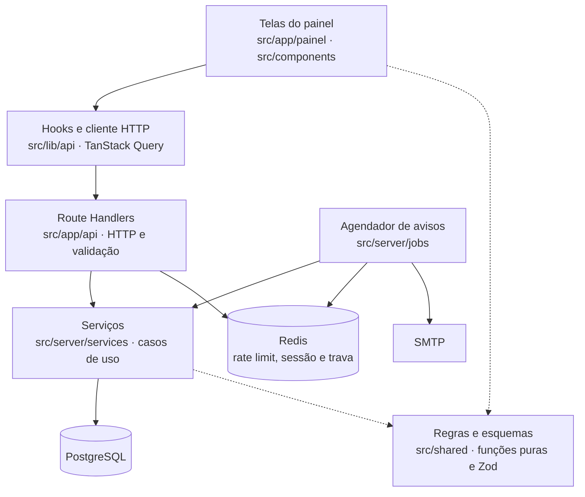

### Modelo de dados

Cada usuário tem uma propriedade, e todos os dados de negócio pertencem a ela.

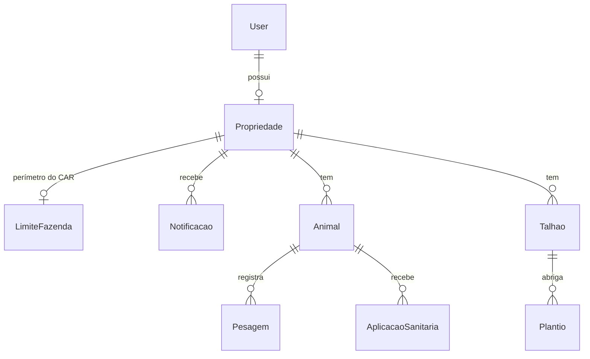

O esquema completo está em [`prisma/schema.prisma`](prisma/schema.prisma). Status do plantio, GMD, situação sanitária e os itens de "Precisa de atenção" são calculados na hora, não armazenados.

### Notificações

O [`instrumentation.ts`](src/instrumentation.ts) agenda uma rodada a cada 30 minutos, protegida por uma trava no Redis para rodar uma vez só entre instâncias. Cada aviso é gravado uma única vez por etapa do prazo, e os e-mails saem agrupados por fazenda, das 7h às 20h no horário de Brasília. O sino do painel também sincroniza os avisos ao ser consultado.

### Estrutura de pastas

```text
├── prisma/                 # esquema, migrations e seed de demonstração
├── public/                 # logos e imagens
├── tests/integration/      # testes de API contra banco real
├── docs/                   # capturas de tela e documentos de design
└── src/
    ├── app/
    │   ├── (auth)/         # login, cadastro, verificação e senha
    │   ├── api/            # Route Handlers da API REST
    │   ├── painel/         # telas autenticadas
    │   └── privacidade/, termos/
    ├── components/
    │   ├── ui/             # primitivos shadcn/ui
    │   ├── sections/       # seções da landing page
    │   └── rebanho/, pesagens/, sanidade/, talhoes/, culturas/, ...
    ├── lib/
    │   ├── api/            # cliente HTTP e hooks do TanStack Query
    │   ├── auth/           # configuração do Better Auth
    │   ├── email/          # envio e templates
    │   └── geo/            # importação do CAR
    ├── server/
    │   ├── http/           # contexto da requisição e formato de erro
    │   ├── jobs/           # agendador de notificações
    │   └── services/       # casos de uso e acesso a dados
    ├── shared/             # regras puras e esquemas Zod
    └── instrumentation.ts  # inicialização do agendador
```

## API REST

Todas as rotas ficam em `/api` e exigem sessão. Cada recurso é filtrado pela fazenda do usuário, e um recurso de outra fazenda responde `404`, sem revelar que existe.

<details>
<summary><strong>Ver rotas</strong></summary>

| Recurso | Rotas |
|---|---|
| Propriedade | `GET` `POST` `PATCH /propriedade` |
| Localização e limite | `GET` `PUT` `DELETE /propriedade/localizacao` · `/propriedade/limite` |
| Animais | `GET` `POST /animais` · `GET` `PATCH` `DELETE /animais/:id` · `GET /animais/lotes` |
| Histórico do animal | `GET` `POST /animais/:id/pesagens` · `GET /animais/:id/sanidade` |
| Pesagens | `GET` `POST /pesagens` · `PATCH` `DELETE /pesagens/:id` · `GET /pesagens/planilha` |
| Sanidade | `GET` `POST /aplicacoes` · `PATCH` `DELETE /aplicacoes/:id` · `GET /aplicacoes/planilha` · `GET /aplicacoes/produtos` · `GET /sanidade/alertas` |
| Talhões | `GET` `POST /talhoes` · `GET` `PATCH` `DELETE /talhoes/:id` |
| Plantios | `GET` `POST /plantios` · `GET` `PATCH` `DELETE /plantios/:id` · `GET /plantios/culturas` · `GET /plantios/safra` |
| Agregados | `GET /visao-geral` · `GET /calendario` · `GET /relatorios/:tipo` |
| Notificações | `GET /notificacoes` · `POST /notificacoes/lidas` |
| Perfil | `PATCH /perfil` · `GET /perfil/dados` |
| Apoio | `GET /geocodificar` |
| Autenticação | `/auth/*` (Better Auth) |

</details>

<details>
<summary><strong>Ver formato de erro</strong></summary>

```json
{
  "error": {
    "code": "VALIDATION_ERROR",
    "message": "Dados inválidos",
    "fields": { "pesoKg": "Informe um peso maior que zero" }
  }
}
```

| Status | Código | Situação |
|---|---|---|
| `400` | `VALIDATION_ERROR` | Entrada inválida |
| `401` | `UNAUTHENTICATED` | Sem sessão |
| `404` | `NOT_FOUND` | Recurso inexistente ou de outra fazenda |
| `409` | `PROPERTY_REQUIRED` | Usuário ainda sem fazenda |
| `409` | `CONFLICT` | Valor único duplicado, como um brinco já usado |
| `409` | `BUSINESS_RULE` | Regra de negócio violada, como ciclos sobrepostos |
| `500` | `INTERNAL_ERROR` | Erro inesperado |

</details>

## Testes

```bash
npm test                  # unitários: regras, esquemas e utilitários
npm run test:integration  # integração: Route Handlers contra PostgreSQL real
```

Os testes de integração criam e migram o banco `farmsense_test` no mesmo PostgreSQL do Docker, sem tocar nos dados de desenvolvimento. Eles cobrem isolamento entre fazendas, autenticação, registro em lote e regras de negócio.

## Produção

```bash
npm ci
npx prisma migrate deploy
npm run build
npm start
```

Além das variáveis acima, é preciso definir `BETTER_AUTH_URL` com o domínio público, usar um SMTP real e cadastrar `https://seu-dominio/api/auth/callback/google` no console do Google, caso o login social esteja ativo. O `.env.example` traz um exemplo com Gmail.

> [!IMPORTANT]
> O agendador de notificações usa um timer dentro do processo Node, então precisa de um servidor de longa duração (`npm start`). Em hospedagem serverless, o timer não continua rodando: os avisos ainda aparecem no sino quando o usuário abre o painel, mas os e-mails de prazo não são enviados.

## Escopo

Para manter o escopo do TCC enxuto, cada conta tem um usuário e uma fazenda. Financeiro, estoque de insumos, atividades no talhão e uso offline ficaram de fora.

As decisões de projeto estão nos [documentos de design](docs/superpowers/specs/). Eles registram o planejamento da época e podem diferir do código atual em alguns pontos.

## Contexto acadêmico

Trabalho de Conclusão de Curso II apresentado ao curso de Ciência da Computação da Universidade Vila Velha (UVV), como parte dos requisitos para obtenção do grau de Bacharel. Contempla a implementação e a validação do sistema, dando continuidade à proposta apresentada no TCC I.

- **Autores:** Lorenzo Simonassi Moura e Thiago Pedro de Almeida
- **Orientador:** Prof. Me. Saulo Pereira Ribeiro

---

<p align="center">© 2026 FarmSense — Projeto acadêmico.</p>
